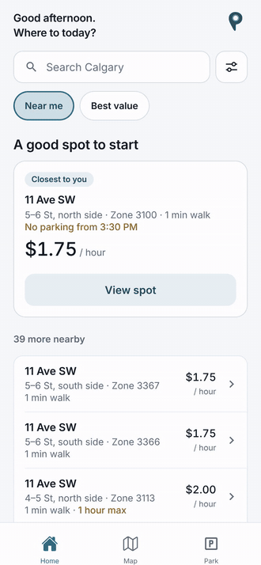
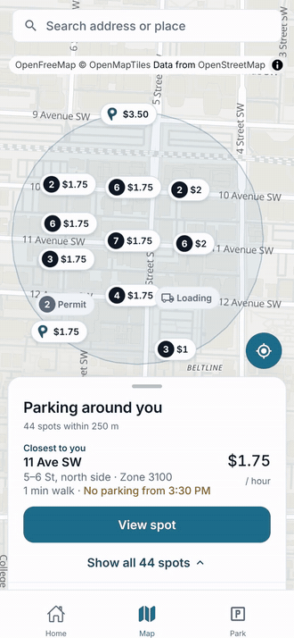
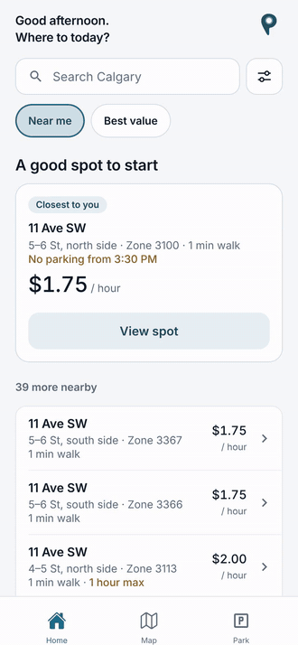
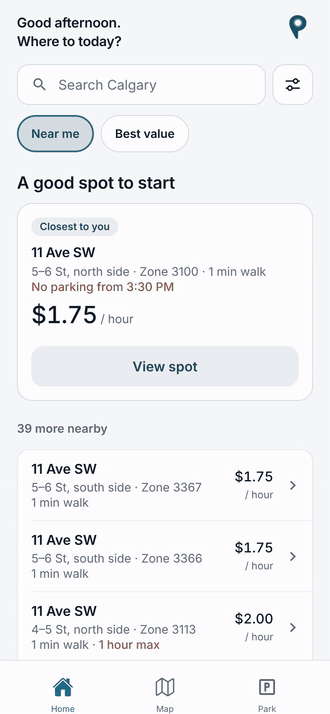
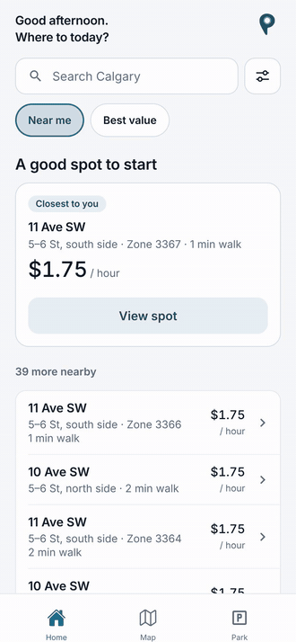
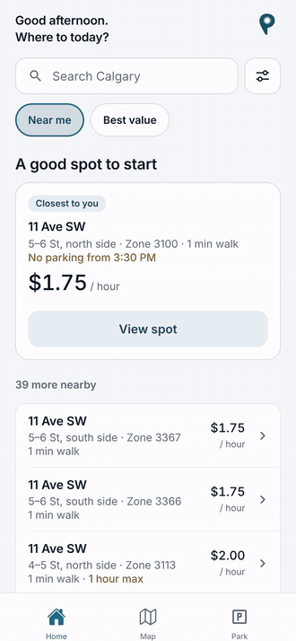
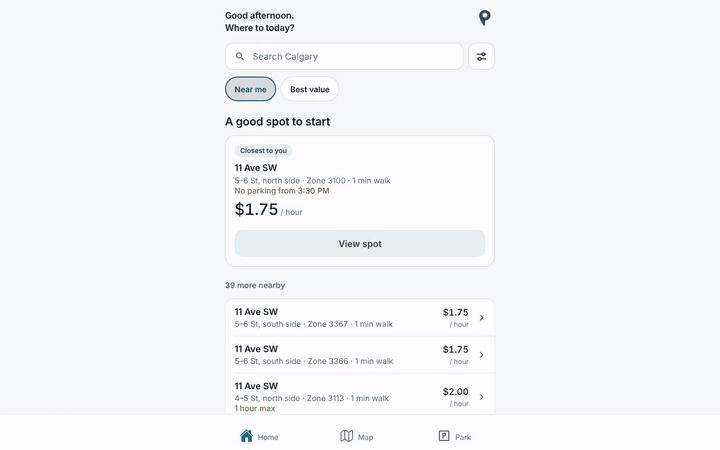

# ParkAid walkthrough

Seven short screen recordings of the app's web build from this repo. Nothing
here is a mockup: each clip is the real app running, tapped through by a script.

- **Data:** the City of Calgary's open-data records for the blocks around
  11 Ave SW and 5 St SW, answered by a local copy of the API that uses the
  backend's own code (`backend/utils/spotRows.js`), not the deployed server.
- **Time:** set to a Tuesday at 1:40 PM. Clip 5 starts at 2:40 PM and jumps
  an hour ahead.
- **Taps:** the blue circle marks each tap. It is added for the recording only.
- **Size:** phone clips are 390 x 844 pt at 2x; the laptop clip is 1280 x 800.

Each clip is a GIF below (it plays on GitHub) and an MP4 for better quality.

## 1. Finding parking

The suggested spot, the list, sorting by best value, and filtering by type and
distance. [MP4](01-find-parking.mp4)

## 2. The map

Pins that would overlap share one pin with a count. A tap on a group zooms in
until its spots part; a tap on a pin selects it. The list opens over the map.
[MP4](02-map.mp4)

## 3. A spot's details

The rate now, the rush-hour times, the City's rates through the day, and the
zone to pay with, copied for MyParking. [MP4](03-spot-details.mp4)

## 4. Parking

Plate and length, the cost before starting, adding time, and ending the
session, with the reminder to end the MyParking session too.
[MP4](04-park-session.mp4)

## 5. Rush hour

At 2:40 PM a block with no parking from 3:30 PM offers 50 minutes at most.
An hour later the list says "No parking until 6:00 PM" and Details offers no
Start. [MP4](05-rush-hour.mp4)

## 6. Details knows where you're parked

On the spot you're parked at, Details shows the time left and View session.
On the block across the street, it says where you're parked and offers
"Park here instead". [MP4](06-parked-here.mp4)

## 7. On a laptop

The tabs sit under the content's column, and the map opens with its list
beside it. [MP4](07-laptop.mp4)

---

Recorded with Playwright and Chrome's screencast at full resolution, encoded
with ffmpeg.
